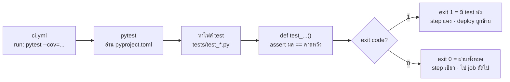

# หมวด 3 · CI: ให้ GitHub รัน test ทุกครั้งที่ push

**จบหมวดนี้:** ทุกครั้งที่ push GitHub จะรัน ruff + pytest ให้เอง และแสดงผลเขียว/แดงในแท็บ Actions · เวลา 20 นาที · ต้องทำ[หมวด 2](02-pytest.md)ก่อน

หมวดนี้เขียนเฉพาะส่วน **CI** (job `test`) ก่อน เพื่อให้เห็นทีละส่วนชัด ๆ ส่วน deploy จะเพิ่มใน[หมวด 4](04-cd.md)

## 3.1 สร้างไฟล์ .github/workflows/ci.yml

ชื่อโฟลเดอร์ต้องตรงเป๊ะ (`.github` มีจุดนำหน้า, `workflows` มี s) ไม่เช่นนั้น GitHub จะหาไม่เจอ ใช้ space 2 ช่อง ห้ามใช้ Tab

```yaml
name: CI/CD

on:
  push:
    branches: [main]
  workflow_dispatch:

jobs:
  test:
    runs-on: ubuntu-latest
    steps:
      - uses: actions/checkout@v4

      - uses: actions/setup-python@v5
        with:
          python-version: "3.13"
          cache: pip
          cache-dependency-path: requirements-dev.txt

      - name: Install dependencies
        run: pip install -r requirements-dev.txt

      - name: Lint
        run: ruff check .

      - name: Test
        run: pytest --cov=grades --cov=build_site --cov-report=term-missing --cov-fail-under=80
```

## 3.2 อธิบายทีละบรรทัด

| บรรทัด | ความหมาย |
| --- | --- |
| `name: CI/CD` | ชื่อ workflow ที่แสดงในแท็บ Actions |
| `on: push: branches: [main]` | เริ่มทำงานทุกครั้งที่ push เข้า branch `main` |
| `workflow_dispatch:` | เพิ่มปุ่ม **Run workflow** ให้กดรันเองได้ |
| `jobs: test:` | สร้าง job ชื่อ `test` (ชื่อนี้จะใช้อีกในหมวด 4 และ 5) |
| `runs-on: ubuntu-latest` | ขอเครื่อง Linux ฟรีจาก GitHub เป็นเครื่องใหม่เปล่า ๆ ทุกครั้ง |
| `actions/checkout@v4` | ดึงโค้ดจาก repo ลงเครื่อง runner (ไม่มีบรรทัดนี้ = เครื่องว่าง ไม่มีไฟล์ให้ test) |
| `actions/setup-python@v5` | ติดตั้ง Python ตามเวอร์ชันที่กำหนด |
| `python-version: "3.13"` | ต้องใส่เครื่องหมายคำพูด เพราะ YAML อ่าน `3.10` เป็นตัวเลข `3.1` |
| `cache: pip` | จำ library ที่ดาวน์โหลดไว้ รอบถัดไปติดตั้งเร็วขึ้น |
| `cache-dependency-path` | บอกว่าให้ดูไฟล์ไหน ถ้าไฟล์นี้เปลี่ยน cache จะถูกสร้างใหม่ |
| `name: Install dependencies` | ชื่อ step ที่จะเห็นใน log (ไม่ใส่ก็ได้ แต่ใส่แล้วอ่าน log ง่ายกว่า) |
| `run: pip install ...` | คำสั่งเดียวกับที่พิมพ์บนเครื่อง ไม่ต้องสร้าง venv เพราะ runner เป็นเครื่องใหม่ทุกครั้งอยู่แล้ว |
| `run: ruff check .` | lint — พังตรงนี้ = โค้ดมีจุดผิดพลาดทั่วไป |
| `run: pytest --cov=...` | รัน test + วัด coverage — พังตรงนี้ = test ไม่ผ่านหรือ coverage ไม่ถึง 80% |

สิ่งที่ต้องจำเพียงข้อเดียว: **ทุกบรรทัด `run:` คือคำสั่งเดียวกับที่นิสิตพิมพ์บนเครื่องในหมวด 2** CI ไม่ใช่เวทมนตร์ มันคือคนอีกคนที่พิมพ์คำสั่งเดิมให้ทุกครั้งที่ push บนเครื่องที่สะอาด เมื่อคำสั่งใดจบด้วย exit code ที่ไม่ใช่ 0 step นั้นจะแดง และ step ที่เหลือจะไม่ถูกรัน



เพราะ pytest หาไฟล์ `test_*.py` เอง การเขียน test เพิ่มจึง**ไม่ต้องแก้ ci.yml** แก้ ci.yml ก็ต่อเมื่อเปลี่ยนวิธีรัน เช่น เพิ่ม library, เปลี่ยนเกณฑ์ coverage หรือเพิ่มเวอร์ชัน Python

## 3.3 Push และดูผล

```bash
git add .
git commit -m "add CI workflow"
git push
```

1. เปิด repo บน GitHub → แท็บ **Actions** จะเห็นงาน "add CI workflow" กำลังรัน (วงกลมสีเหลือง)
2. คลิกเข้าไป → คลิก job **test** จะเห็นทุก step เรียงกัน คลิกที่ step **Test** จะเห็นตาราง coverage เหมือนบนเครื่อง
3. รอประมาณ 30 วินาที จะกลายเป็นเครื่องหมายถูกสีเขียว

## 3.4 ทดลองให้ CI แดง 2 แบบ

| ทำอะไร | step ที่แดง | ข้อความที่จะเห็นใน log |
| --- | --- | --- |
| เพิ่ม `import os` บนสุดของ `grades.py` (import แต่ไม่ใช้) | **Lint** | ``F401 [*] `os` imported but unused`` |
| แก้คะแนนใน `data/scores.csv` ให้คนหนึ่งเป็น `850` | **Test** | `FAILED tests/test_build_site.py::test_real_data_file_is_valid` |

ทดลองทีละแบบ push แล้วดูว่า step ที่ตามมาถูกข้าม จากนั้นแก้กลับและ push ให้เขียวก่อนไปต่อ GitHub จะส่งอีเมลแจ้งทุกครั้งที่ workflow พัง

## สรุปหมวด 3

- [ ] แท็บ Actions มีงานสีเขียว
- [ ] เปิด log ดูตาราง coverage ได้
- [ ] เคยทำให้ Lint แดงและ Test แดง แล้วแก้กลับเขียว

ต่อไป: [หมวด 4 · CD](04-cd.md)
