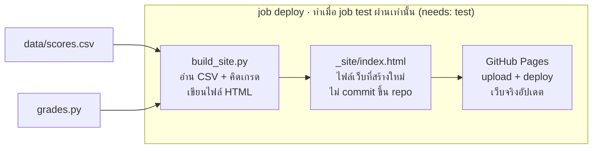

# หมวด 4 · CD: deploy เว็บที่สร้างด้วย Python

**จบหมวดนี้:** เว็บผลคะแนนอยู่ที่ `https://<username>.github.io/hello-python/` และอัปเดตเองทุกครั้งที่ push และ test ผ่าน · เวลา 20 นาที · ต้องทำ[หมวด 3](03-ci.md)ก่อน

CD เพิ่ม job ที่ 2 ชื่อ `deploy` ต่อจาก `test` มันจะรัน `python build_site.py` สร้างเว็บแล้วส่งขึ้น GitHub Pages แต่**เฉพาะตอนที่ test ผ่านแล้วเท่านั้น**



ทุกอย่างในกรอบเกิดขึ้นบน runner หลัง test ผ่านเท่านั้น นิสิตแก้แค่กล่องซ้ายสุด (ข้อมูลหรือโค้ด) แล้ว push ที่เหลือ CD ทำให้เอง

## 4.1 เปิด GitHub Pages (ทำครั้งเดียว)

1. เปิด repo `hello-python` → **Settings** → เมนูซ้าย **Pages**
2. หัวข้อ **Build and deployment** → **Source** เลือก **GitHub Actions**
3. ไม่ต้องกด Save (บันทึกอัตโนมัติ)

ถ้าข้ามขั้นนี้ job deploy จะ error `Get Pages site failed` หรือ 404

## 4.2 ci.yml ฉบับเต็ม (CI + CD)

แทนที่ไฟล์เดิมทั้งไฟล์ ส่วนที่เพิ่มจากหมวด 3 มี 2 จุด: หัวข้อ `permissions` และ job `deploy`

```yaml
name: CI/CD

on:
  push:
    branches: [main]
  workflow_dispatch:

permissions:
  contents: read
  pages: write
  id-token: write

jobs:
  test:
    runs-on: ubuntu-latest
    steps:
      - uses: actions/checkout@v4
      - uses: actions/setup-python@v5
        with:
          python-version: "3.13"
          cache: pip
          cache-dependency-path: requirements-dev.txt
      - name: Install dependencies
        run: pip install -r requirements-dev.txt
      - name: Lint
        run: ruff check .
      - name: Test
        run: pytest --cov=grades --cov=build_site --cov-report=term-missing --cov-fail-under=80

  deploy:
    needs: test
    runs-on: ubuntu-latest
    environment:
      name: github-pages
      url: ${{ steps.deployment.outputs.page_url }}
    steps:
      - uses: actions/checkout@v4
      - uses: actions/setup-python@v5
        with:
          python-version: "3.13"
      - name: Build site
        run: python build_site.py
      - uses: actions/configure-pages@v5
      - uses: actions/upload-pages-artifact@v3
        with:
          path: _site
      - id: deployment
        uses: actions/deploy-pages@v4
```

## 4.3 อธิบายส่วนที่เพิ่ม

| บรรทัด | ความหมาย |
| --- | --- |
| `permissions:` | อนุญาตให้ workflow อ่านโค้ด (`contents: read`) และเขียนขึ้น Pages (`pages: write`, `id-token: write`) ขาดอันไหน deploy จะพัง |
| `needs: test` | **หัวใจของ CD** — รอ job `test` เขียวก่อน ถ้า test แดง job นี้จะถูกข้าม (skipped) |
| `environment: github-pages` | ผูกกับพื้นที่ Pages และแสดงลิงก์เว็บใต้กล่อง deploy |
| `setup-python` (ไม่มี `pip install`) | `build_site.py` ใช้แค่ library ที่มากับ Python (`csv`, `html`, `os`) จึงไม่ต้องติดตั้งอะไรเพิ่ม |
| `run: python build_site.py` | สร้าง `_site/index.html` จาก `data/scores.csv` — คำสั่งเดียวกับที่รันบนเครื่อง |
| `upload-pages-artifact` + `path: _site` | แพ็กโฟลเดอร์ `_site` เตรียมขึ้นเว็บ |
| `deploy-pages` | นำไฟล์ขึ้น GitHub Pages |

ทำไมไม่ commit โฟลเดอร์ `_site` ขึ้น repo? เพราะมันคือ**ผลลัพธ์**ที่สร้างจากโค้ดกับข้อมูล ให้ CD สร้างใหม่ทุกครั้งดีกว่า เว็บจะตรงกับโค้ดเสมอ (เราใส่ `_site/` ไว้ใน `.gitignore` ตั้งแต่หมวด 1)

## 4.4 Push และเปิดเว็บ

```bash
git add .
git commit -m "add deploy job"
git push
```

1. แท็บ **Actions** → คลิกงานล่าสุด จะเห็น 2 กล่อง `test` → `deploy` ต่อกัน
2. รอประมาณ 1–2 นาทีจนเขียวทั้งคู่
3. ใต้กล่อง `deploy` มีลิงก์ `https://<username>.github.io/hello-python/` คลิกเปิดจะเห็นตารางคะแนน 4 คนและค่าเฉลี่ย 67.25

## 4.5 ทดลอง CD จริง 2 สถานการณ์

**สถานการณ์ที่ 1 — อัปเดตข้อมูลถูกต้อง:** เพิ่มบรรทัด `ชูใจ,91` ท้าย `data/scores.csv` แล้ว push → รอ 1–2 นาที → รีเฟรชเว็บ (`Ctrl+Shift+R`) จะเห็น 5 คนและชูใจได้ A โดยไม่ได้แตะโค้ดเลย

**สถานการณ์ที่ 2 — พิมพ์ข้อมูลผิด:** เพิ่มบรรทัด `วีณา,850` แล้ว push → job `test` แดงที่ `test_real_data_file_is_valid` → job `deploy` ถูกข้าม → **เว็บยังแสดงข้อมูลเดิมที่ถูกต้อง** นี่คือประโยชน์จริงของ CI/CD: ของผิดไม่หลุดขึ้นเว็บ แก้เป็น `85` แล้ว push อีกครั้ง เว็บจะอัปเดต

## สรุปหมวด 4

- [ ] ตั้ง Pages Source เป็น GitHub Actions แล้ว
- [ ] `test` และ `deploy` เขียวทั้งคู่ เปิดเว็บได้
- [ ] แก้ CSV แล้วเว็บอัปเดตเอง
- [ ] ใส่คะแนนผิดแล้วเห็นว่า deploy ถูกข้าม เว็บไม่เปลี่ยน

จบหมวด 4 = ได้ CI/CD ครบวงจรแล้ว หมวด 5–8 เป็นเรื่องเสริม ทำต่อหมวดไหนก็ได้
