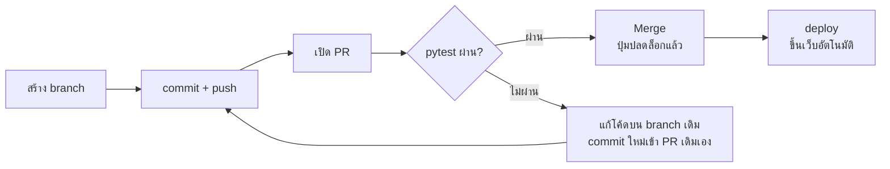

# หมวด 5 · ทำงานเป็นทีมด้วย Pull Request

**จบหมวดนี้:** ทุกคนแก้โค้ดบน branch ของตัวเองแล้วเปิด Pull Request (PR) ปุ่ม Merge จะกดไม่ได้จนกว่า test จะเขียว · เวลา 30 นาที · ต้องทำ[หมวด 4](04-cd.md)ก่อน

**ทำไมต้องมี?** ตอนนี้เรา push ตรงเข้า `main` ถ้า test พัง โค้ดพังก็เข้า `main` ไปแล้ว (แค่ไม่ถูก deploy) ในทีมจริง `main` ต้องพร้อมใช้งานตลอดเวลา จึงให้ CI ตรวจที่ PR ก่อน merge



ปุ่ม Merge กดได้เมื่อ pytest ผ่านเท่านั้น ถ้าไม่ผ่านให้แก้บน branch เดิมแล้ว push ซ้ำ CI จะรันใหม่ใน PR เดิมเอง

## 5.1 แก้ ci.yml 2 จุด

```yaml
on:
  push:
    branches: [main]
  pull_request:            # ใหม่: รันตอนเปิดหรืออัปเดต PR
    branches: [main]       # ใหม่: เฉพาะ PR ที่จะ merge เข้า main
  workflow_dispatch:

# ... permissions และ job test เหมือนเดิม ...

  deploy:
    needs: test
    if: github.event_name != 'pull_request'   # ใหม่: PR ไม่ deploy
    runs-on: ubuntu-latest
```

| บรรทัด | ความหมาย |
| --- | --- |
| `pull_request: branches: [main]` | รัน test ทุกครั้งที่เปิด PR เข้า `main` และทุกครั้งที่ push เพิ่มเข้า PR นั้น (`main` คือ branch **ปลายทาง**) |
| `if: github.event_name != 'pull_request'` | ถ้าเหตุการณ์คือ PR ให้ข้าม deploy เพราะโค้ดใน PR ยังไม่ผ่านการรีวิว |

Commit และ push เข้า `main` ตามปกติก่อน เพื่อให้ workflow รันอย่างน้อย 1 ครั้ง (จำเป็นสำหรับขั้น 5.2)

## 5.2 ตั้ง Branch protection

1. repo → **Settings** → เมนูซ้าย **Branches** → **Add classic branch protection rule** (บางบัญชีเป็น **Add branch ruleset** ตั้งค่าได้ผลเหมือนกัน)
2. **Branch name pattern**: `main`
3. ติ๊ก **Require a pull request before merging**
    - ทำคนเดียว: เอาติ๊ก **Require approvals** ออก ไม่เช่นนั้นต้องมีคนอื่น Approve ก่อน
4. ติ๊ก **Require status checks to pass before merging** → ช่องค้นหาพิมพ์ `test` แล้วเลือก (ชื่อ job ใน ci.yml)
5. ติ๊ก **Do not allow bypassing the above settings** — สำคัญ: ถ้าไม่ติ๊ก เจ้าของ repo จะข้ามกฎได้เสมอ
6. กด **Create**

## 5.3 ทดลอง: เพิ่มฟังก์ชันที่มี bug ผ่าน PR

**ขั้นที่ 1 — สร้าง branch ใหม่** (อย่าแก้บน `main`)

```bash
git switch main
git pull
git switch -c feature/pass-rate
```

**ขั้นที่ 2 — เพิ่มฟังก์ชันท้าย `grades.py`** (มี bug โดยตั้งใจ: คนได้ 50 ควรนับว่าผ่าน)

```python
def pass_rate(scores):
    """เปอร์เซ็นต์คนที่ได้ 50 คะแนนขึ้นไป"""
    passed = [s for s in scores if s > 50]
    return round(len(passed) / len(scores) * 100, 2)
```

**ขั้นที่ 3 — เพิ่ม test ใน `tests/test_grades.py`**

```python
from grades import average, grade, pass_rate   # แก้บรรทัด import เดิม


def test_pass_rate():
    assert pass_rate([80, 50, 40, 30]) == 50
```

**ขั้นที่ 4 — push branch และเปิด PR**

```bash
git add .
git commit -m "add pass_rate"
git push -u origin feature/pass-rate
```

เปิดหน้า repo จะมีแถบสีเหลือง **Compare & pull request** → กด → กด **Create pull request**

**ขั้นที่ 5 — ดูผลใน PR:** check `test` เป็นกากบาทแดง ปุ่ม Merge กดไม่ได้ คลิก **Details** จะเห็น

```
FAILED tests/test_grades.py::test_pass_rate - assert 25.0 == 50
```

อ่านได้ว่า 4 คน ผ่านแค่ 1 คน (25%) แต่ควรเป็น 2 คน (50%) คนที่ได้ 50 หายไป

**ขั้นที่ 6 — แก้บน branch เดิม:** เปลี่ยน `s > 50` เป็น `s >= 50` → `pytest` บนเครื่องต้องขึ้น `19 passed` → commit และ `git push` (ไม่ต้องเปิด PR ใหม่ commit ใหม่เข้า PR เดิมเอง)

**ขั้นที่ 7 — Merge:** check เขียวแล้วกด **Merge pull request** → workflow รันอีกรอบจาก push เข้า `main` ครั้งนี้ deploy ทำงาน

**ขั้นที่ 8 — เก็บกวาดบนเครื่อง**

```bash
git switch main
git pull
git branch -d feature/pass-rate
```

ตั้งแต่นี้ถ้า `git push` ตรงเข้า `main` จะถูกปฏิเสธ (`GH006: Protected branch update failed`) นั่นคือพฤติกรรมที่ถูกต้อง

## สรุปหมวด 5

- [ ] PR ที่ test พัง merge ไม่ได้
- [ ] แก้แล้ว push ซ้ำ check เปลี่ยนเป็นเขียวเอง
- [ ] หลัง merge เว็บ deploy อัตโนมัติ
- [ ] push ตรงเข้า `main` ถูกปฏิเสธ
