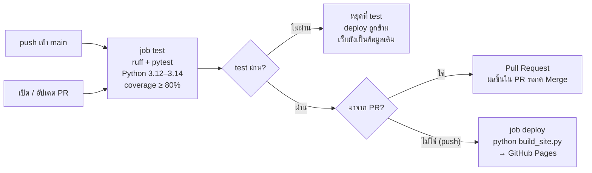

# คู่มือ GitHub Actions ภาค 2 — CI/CD ด้วย Python

คู่มือนี้พาทำ CI/CD ด้วย **Python** ตั้งแต่ต้นจนได้เว็บจริง แบ่งเป็น 9 หมวด ทำตามลำดับทีละหมวด หมวด 1–4 คือแกนหลักที่ทุกคนต้องทำ หมวด 5–8 เป็นเรื่องเสริม ทำหมวดไหนก่อนก็ได้

โค้ดตัวอย่างฉบับเต็มที่ทดสอบแล้วอยู่ที่ [`examples/python-cicd/`](../examples/python-cicd/)

## CI/CD คืออะไร (อธิบายแบบง่าย)

| คำ | ความหมาย | เปรียบเทียบ |
| --- | --- | --- |
| **CI** (Continuous Integration) | ทุกครั้งที่ push โค้ด GitHub จะรัน test ให้อัตโนมัติ | อาจารย์ตรวจการบ้านให้ทันทีที่ส่ง |
| **CD** (Continuous Deployment) | ถ้า test ผ่าน ระบบจะนำงานขึ้นเว็บให้อัตโนมัติ | การบ้านที่ตรวจผ่านแล้วถูกติดบอร์ดให้เอง |
| **Workflow** | ไฟล์ `.github/workflows/ci.yml` ที่บอกว่าต้องทำอะไร เมื่อไหร่ | ใบสั่งงาน |
| **Job / Step** | workflow แบ่งเป็น job (เช่น test, deploy) แต่ละ job มีหลาย step | หัวข้อใหญ่ / ข้อย่อยในใบสั่งงาน |
| **Runner** | เครื่องที่ทำงานตามใบสั่ง GitHub ให้ใช้ฟรี (`ubuntu-latest`) เป็นเครื่องใหม่ทุกครั้ง | พนักงานที่รับใบสั่งงาน |

## โปรเจกต์ที่จะทำ: เว็บประกาศผลคะแนน

โปรแกรม Python อ่านคะแนนจากไฟล์ `data/scores.csv` คำนวณเกรด แล้วสร้างหน้าเว็บตารางผลคะแนน เมื่อเสร็จทุกหมวด แค่แก้คะแนนในไฟล์ CSV แล้ว push ระบบจะ test → สร้างเว็บ → อัปเดตเว็บให้เองภายใน 1–2 นาที

อ่านจากซ้ายไปขวา: ทุกทางต้องผ่าน job test ก่อน ถ้าไม่ผ่านเว็บจะไม่ถูกแตะ ถ้ามาจาก PR จะหยุดรอ Merge และการ Merge ก็คือ push เข้า main ที่วนกลับมาเริ่มที่ซ้ายบน

| ไฟล์ | หน้าที่ |
| --- | --- |
| `grades.py` | ฟังก์ชันคำนวณเกรดและค่าเฉลี่ย |
| `build_site.py` | อ่าน CSV แล้วเขียนหน้าเว็บ `_site/index.html` |
| `tests/` | test ทั้งหมด 18 ตัว (เขียนด้วย pytest) |
| `.github/workflows/ci.yml` | ใบสั่งงานให้ GitHub: test แล้ว deploy |

โค้ดทุกไฟล์ในคู่มือนี้ทดสอบรันจริงแล้วบน Python 3.13 (18 test ผ่าน, coverage 97%)

## แผนที่หมวด

| หมวด | ทำเสร็จแล้วได้อะไร | เวลา |
| --- | --- | --- |
| [1 · เตรียมโปรเจกต์](01-setup.md) | โปรเจกต์ Python ที่พร้อมใช้ บนเครื่องและบน GitHub | 20 นาที |
| [2 · เขียน test (pytest)](02-pytest.md) | เขียน test เองเป็น รัน test และอ่านผลเมื่อพัง | 40 นาที |
| [3 · CI (ci.yml)](03-ci.md) | GitHub รัน test ให้ทุกครั้งที่ push | 20 นาที |
| [4 · CD (deploy)](04-cd.md) | เว็บจริงที่อัปเดตเองเมื่อ test ผ่าน | 20 นาที |
| [5 · Pull Request](05-pull-request.md) | ห้าม merge โค้ดที่ test ไม่ผ่าน (ทำงานเป็นทีม) | 30 นาที |
| [6 · Secrets](06-secrets.md) | เก็บค่าตั้งค่าและรหัสลับนอกโค้ด | 20 นาที |
| [7 · Matrix](07-matrix.md) | test หลายเวอร์ชัน Python พร้อมกัน | 15 นาที |
| [8 · Self-hosted runner](08-self-hosted-runner.md) | ใช้เครื่องตัวเองเป็น runner | 30 นาที |
| [9 · แก้ปัญหา + แบบฝึกหัด](09-troubleshooting.md) | แก้ปัญหาที่เจอบ่อย + แบบฝึกหัด | — |

## ต้องมีอะไรก่อนเริ่ม

| สิ่งที่ต้องมี | คำสั่งตรวจ | หมายเหตุ |
| --- | --- | --- |
| บัญชี GitHub | — | ทำภาค 1 เสร็จแล้วจะคุ้นกับ Actions และ Pages |
| Git | `git --version` | ตั้งค่า `user.name` / `user.email` แล้ว |
| Python 3.12 ขึ้นไป | `python --version` | Windows ตอนติดตั้งติ๊ก **Add python.exe to PATH** (macOS ใช้ `python3`) |
| VS Code + ส่วนขยาย Python | — | เพิ่มส่วนขยาย YAML ด้วย จะเตือนเมื่อย่อหน้า ci.yml ผิด |
